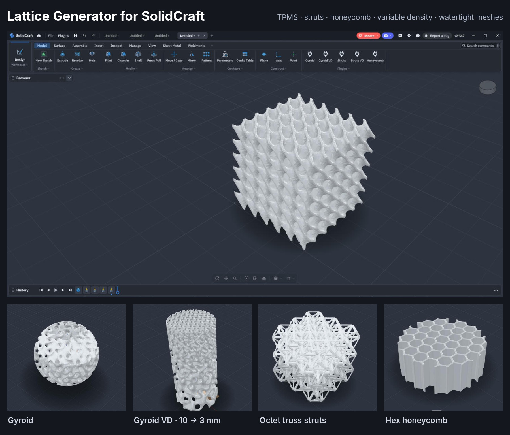

# Lattice Generator for SolidCraft

Gyroid / TPMS, strut and honeycomb lattices for [SolidCraft](https://github.com/tangency-labs/solidcraft). Select a body, click a button, and the body is filled with a watertight mesh lattice in a few seconds.



▶️ [Turntable video](docs/turntable.mp4)

## Download and install

1. Download **[release/lattice.zip](release/lattice.zip?raw=1)** (v0.5.2).
2. In SolidCraft (0.43 or newer): **⚙ Preferences → Plugins → Install plugin…** and pick `lattice.zip`.
3. Five buttons appear on the **Model** ribbon under **Plugins**: Gyroid, Gyroid VD, Struts, Struts VD, Honeycomb.

The plugin asks for up to 512 MiB of memory. If SolidCraft refuses to run it, raise **Max plugin memory** on the same Plugins page (for example to 1024).

## Use

1. Click the body (or any face of it) in the viewport.
2. Click a lattice button, set the options and press **Run**.
3. The lattice is added as mesh bodies named after **Result name** (default "Lattice"). The original body stays, so hide it to see the lattice.

| Button | Lattices | Options |
|---|---|---|
| **Gyroid** | Gyroid, Radial Gyroid, Schwarz Diamond, Schwarz Primitive, Schoen IWP, Neovius | Sheet or solid fill, cell size, wall thickness, resolution, origin, shell (solid skin) |
| **Gyroid VD** | Same as Gyroid | Variable density: axis, plus a cell size and a wall thickness at each control point |
| **Struts** | Simple Cubic, BCC, BCC (pure), BCC-Z, FCC, FCC-Z, Octet Truss, Octahedron, Kelvin Cell, Diamond, Rhombic Dodecahedron, Re-entrant 3D, Double Arrowhead | Cell size, strut diameter, node spheres, origin |
| **Struts VD** | Same as Struts | Variable density along an axis (a cell size and a strut diameter at each control point) |
| **Honeycomb** | Hexagonal, Square, Triangular | Axis, cell size, wall thickness, origin |

**Control points (VD):** comma-separated lists, for example cell sizes `10, 6, 3` and walls `1, 0.8, 0.6`. With **Even Spacing** on, the points are spread evenly from one end of the body to the other along the axis. Turn it off and fill in **Point positions** (mm from the start) to place them yourself.

**Resolution:** `0` = automatic. Lower values give smoother walls and struts but take longer. SolidCraft gives a plugin 30 seconds per run, so very large parts are coarsened automatically, and the plugin tells you if the walls are too thin for the part's size.

## How it works

Every lattice is a distance field (a TPMS surface, capsules around struts, or a 2D tiling extruded along an axis) sampled on a grid and cut to the body's own triangles. It is meshed with manifold dual contouring, simplified with quadric error metrics, and added to SolidCraft as embedded mesh bodies. Large lattices are split into slabs that share a layer, so there are no gaps between them.

- `plugin/`: the SolidCraft plugin (Rust → WebAssembly component, `craft:plugin@0.1.0`)
- `gyroid/`: the lattice engine; also a standalone multi-threaded command-line tool (`gyroid.exe`) that writes STL files, for parts too big for SolidCraft's 30 s limit

## Build from source

Requires Rust, plus a one-time `rustup target add wasm32-unknown-unknown` and `cargo install wasm-tools`.

```
cd plugin
./build.sh        # or build.cmd on Windows; writes plugin/dist/lattice.zip
```

`plugin.json` (the dialogs) is generated by `python gen_manifest.py`. Tests: `cargo test --release` in `plugin/` and `gyroid/`.

## License

MIT
